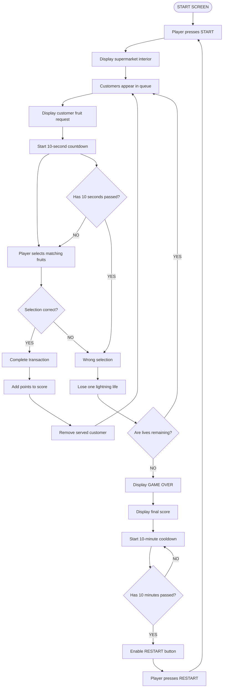

<div align="center">

# 🛒 QUEUEMART

### Supermarket Queue Simulator

**Every Customer Counts. Every Second Matters!**

A Supermarket Cashier Simulation Game developed for CC 104.

</div>

---

## 📖 About the Project

QueueMart is a supermarket cashier simulation game developed as a project for the CC 104 subject. The game allows players to experience managing a supermarket checkout counter by serving customers, checking their requested fruits, and completing transactions within a time limit.

The main goal is to serve customers correctly, earn points, and keep the queue moving while managing the available lives.

## 🎮 Game Features

- **Customer Queue System** – Customers appear and wait in line to be served.
- **Fruit Selection** – Players must select the correct fruits requested by customers.
- **Timer System** – Complete each transaction before the 10-second countdown ends.
- **Scoring System** – Earn points for every correct transaction.
- **Lives System** – Players have three lightning lives.
- **Game Over System** – The game ends when all three lives are lost.
- **Restart Cooldown** – Players must wait 10 minutes before restarting after a game over.

---

## 📊 Game Flowchart

The following flowchart shows the overall process and gameplay of QueueMart.



---

## 🕹️ How to Play

1. Press the **START** button.
2. Wait for customers to enter the queue.
3. Check the fruits requested by the customer.
4. Select the matching fruits.
5. Complete the transaction before the 10-second countdown ends.
6. Earn points for correct selections.
7. Avoid losing all three lightning lives.
8. If the game ends, wait for the 10-minute cooldown before restarting.

---

## 🎯 Game Objective

Serve customers correctly, earn the highest possible score, manage your remaining lives, and keep the supermarket queue moving.

---

## 🛠️ Project Information

| Information | Details |
|:---|:---|
| Project Name | QueueMart |
| Subject | CC 104 |
| Project Type | Simulation Game |
| Genre | Supermarket / Cashier Simulation |
| Platform | PC |

---

## 📂 Project Structure

```text
CC-104-PROJECT/
│
├── README.md
├── images/
│   ├── main-menu.png
│   ├── gameplay.png
│   └── game-over.png
│
└── project-files/
```

---

<div align="center">

# 🛒 QUEUEMART

**Thank you for checking out our project!**

*Every Customer Counts. Every Second Matters!*

</div>
